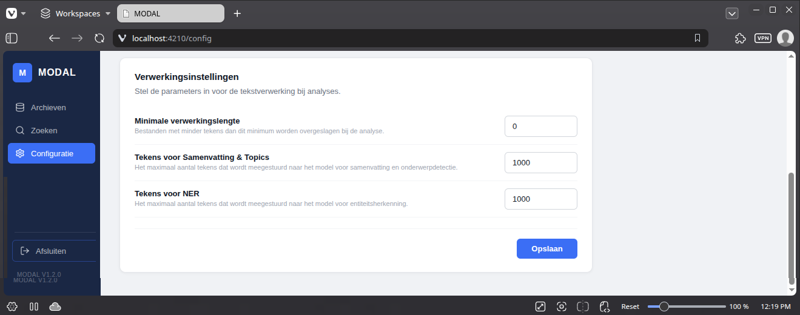

## **Verwerkingsinstellingen** ##

Stel de parameters in voor de tekstverwerking bij analyses:

* **Minimale verwerkingslengte:** 
    * Bestanden met minder tekens dan dit minimum worden overgeslagen bij de analyse. Dit zorgt er voor dat er geen analyse wordt uitgevoerd op weinig betekenisvolle bestanden.

* **Tekens voor Samenvatting & Topics:**
    * Het maximaal aantal tekens dat door het AI-model wordt gebruikt voor het maken van samenvattings en onderwerpdetectie.
    * Default: 1000

* **Tekens voor NER:**
    * Het maximaal aantal tekens waarin entiteitsherkenning (NER) wordt uitgevoerd.
    * Default: 1000

__Opmerking__: als je zeker wil zijn dat heel lange teksten (>3000 woorden) volledig worden geanalyseerd, controleer dan ook of de [context window](fixes.md#context-window) lang genoeg is.

## Opmerkingen ##
* Vaak volstaan de eerste zinnen van een document om de inhoud te duiden.
* Hoe groter het gebruikte tekstfragment, hoe langer de analyse duurt. Bij hoge aantallen kan de app vastlopen.
* Als je het maximaal aantal tekens op '0' zet, wordt de volledige tekst gebruikt.

# Semantisch zoeken

Semantisch zoeken bevat volgende parameters voor het genereren van embeddings en voor zoekopdrachten op betekenis.

* **Fragmentgrootte:** 
    * Aantal tekens per fragment. Grotere fragmenten verbeteren het resultaat, maar zoekacties zullen trager zijn.

* **Maximum aantal fragmenten per bestand:**
    * Begrenst het aantal fragmenten per bestand bij het maken van embeddings. Hoe meer fragmenten, hoe beter het resultaat, maar hoe trager de zoekactie.
    * Geen limiet: de volledige tekst wordt embed.

* **Maximale afstand:**
    * Afstand is een maat voor de semantische overeenkomst tussen de zoekvraag en de tekst. Hoe groter de afstand, 
  hoe lager de semantische overeenkomst en dus hoe meer resultaten. Hogere afstand levert dus minder relevante resultaten op. Resultaten met een grotere afstand dan deze waarde worden niet getoond.

* **Aantal resultaten:**
    * Het maximale aantal zoekresultaten dat wordt getoond.

* **Opmerking:** als je de instellingen aanpast, kan je de embeddings van een archief [vernieuwen.](http://0.0.0.0:8000/search/#stappen)  