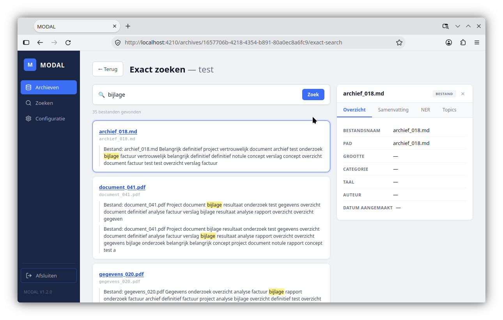
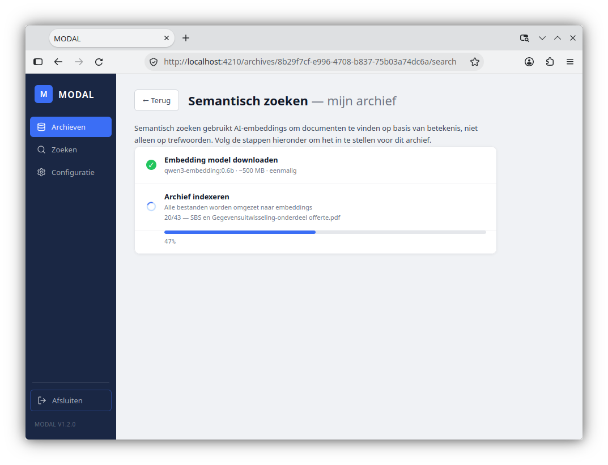
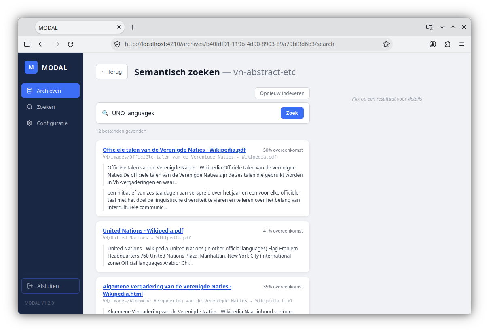

# Archieven doorzoeken

## Twee vormen van zoeken

Er zijn meerdere zoekmogelijkheden:

1. Zoeken op tekst
2. Semantisch zoeken
3. Zoeken op bestandnaam

## Zoeken op tekst
Hierbij wordt gezocht op een exacte overeenkomst met de gezochte tekst. Er wordt steeds gezocht in het volledige archief.

### Stappen
1. Open de archiefbrowser en klik op een archief.
2. Klik op de knop 'Exact zoeken'.
3. Geef een zoekterm in en klik Enter.

## Semantisch zoeken
Bij semantisch zoeken wordt **taalonafhankelijk** gezocht op **betekenis** van een woord. Teksten met woorden die semantisch verwant zijn aan de zoektekst, verschijnen bovenaan de resultaatlijst.

### Voorbeeld:

| term     | vind teksten over                                   |
|:---------|:----------------------------------------------------|
| kunst    | kunst, kunstenaar, artiest, schilderij, theater ... |
| politiek | politiek, parlement, partijpolitiek ...             |
| digital sustainability| digitale duurzaamheid ...                              

Semantisch zoeken maakt gebruik van **Vector embeddings**. Dit zijn numerieke representaties ('vectoren')
van woorden of zinnen die hun betekenissen vastleggen. Door vectoren te vergelijken kunnen identieke en verwante woorden of concepten worden gevonden.

### Opmerkingen
1. Als je met de MODAL app de eerste keer semantisch wil zoeken, wordt het model **gedownload en automatisch geinstalleerd**. MODAL maakt gebruik van het compacte model [qwen3-embedding:0.6b](https://ollama.com/library/qwen3-embedding:0.6b) (ca. 600 MB).
2. Semantisch zoeken wordt uitgevoerd op de eerste X fragmenten van elke tekst. In het [Configuratie-menu](configuratie.md) kan je het aantal fragementen en hun lengte aanpassen.

### Stappen
1. Open de archiefbrowser en klik op een archief.
2. Ga naar de map die je wil doorzoeken.
3. Klik op de knop 'Semantisch zoeken'.
4. Wanneer het model  gedownload is, klik dan op **Archief indexeren**. Dit moet je voor elk archief slechts eenmalig uitvoeren.
 
5. Geef een zoekterm in en klik Enter.

## Zoeken op bestandsnaam
1. Klik in het Archievenoverzicht op de knop 'Verkennen'.
2. Ga naar een willekeurige folder.
3. Klik op de knop 'Per map': je ziet nu alle documenten in de actieve folder.
4. Klik in het val 'Zoek op bestandsnaam'. Je kan hiermee zoeken in de bestandsnamen van de actieve folder (maar niet van de subfolders).