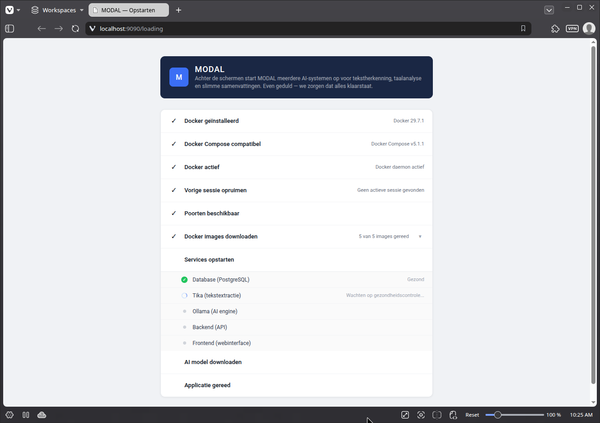
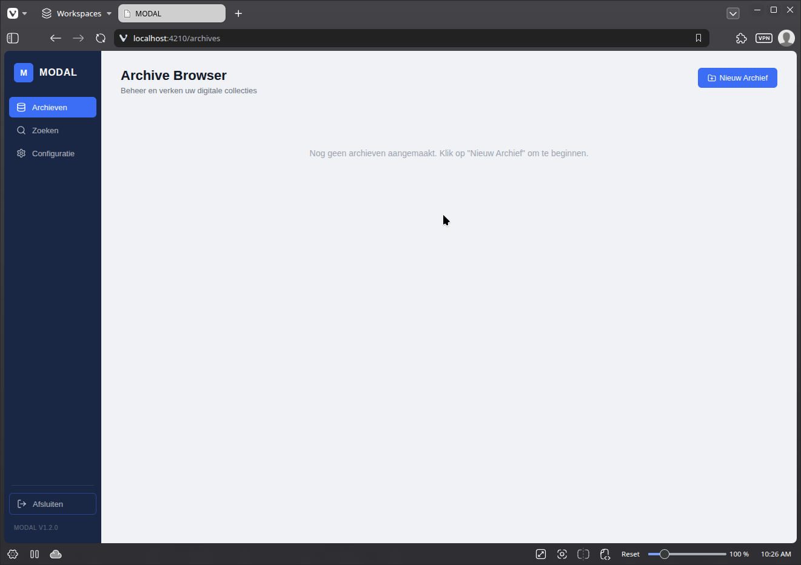
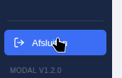

# **Start de applicatie** 

## **Windows** 

### **Start Docker** 

* Zoek naar Docker en selecteer Docker Desktop in de zoekresultaten.  
  * Bij een eerste gebruik toont het Docker-menu de Docker-abonnementsovereenkomst.  
  * Selecteer Accepteren om verder te gaan.   
  * Docker Desktop start nadat je de voorwaarden hebt geaccepteerd.

### **Start de MODAL-app** 

* Ga naar de folder `archive-app-windows`.
* Dubbelklik op het bestand `archive-agent.exe`.   
* De applicatie opent in je default browser.

## **macOS** 

### **Start Docker** 


### **Start de MODAL-app** 

* Ga naar de folder `archive-app-macos-arm64`.
* Dubbelklik op het bestand `archive-agent`.
* De applicatie opent in je default browser.


## **Linux** 

### **Start Docker** 

* Controleer of Docker actief is, bv. met:

```shell
docker ps
```

* Als Docker niet actief is, start dan op met:

```shell
systemctl start docker
```

### **Start de MODAL-app** 

* Ga naar de folder `archive-app-linux`  
* Dubbelklik op het bestand `archive-agent`  
* De applicatie opent in je default browser. Je krijgt een scherm te zien waarin je het opstartproces kan volgen. Bij een eerste opstart kan dit even duren.  


<figcaption>Het MODAL opstartscherm toont de status van alle componenten</figcaption>

* Wanneer het opstartproces voltooid is, verschijnt het MODAL-archievenoverzicht



## **De applicatie stoppen**

Je kan de applicatie afsluiten met de knop 'Afsluiten' links onderaan.  
